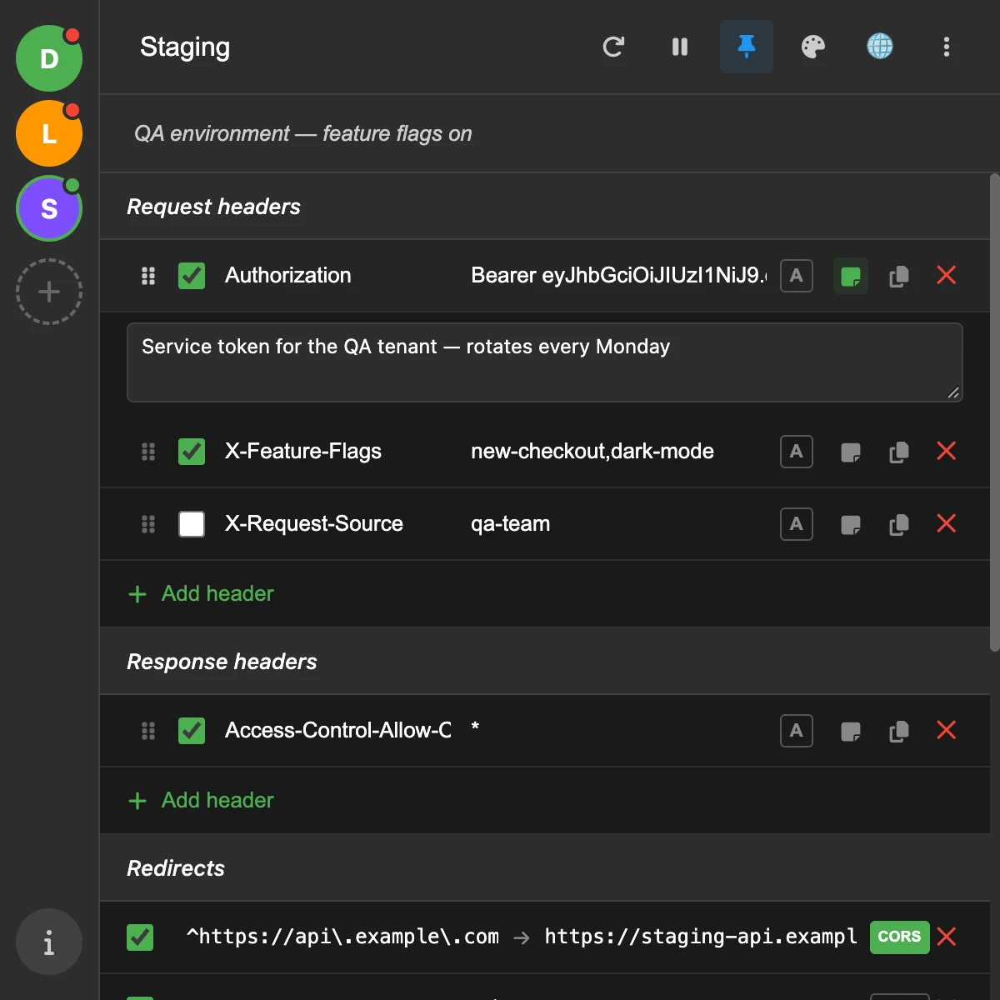
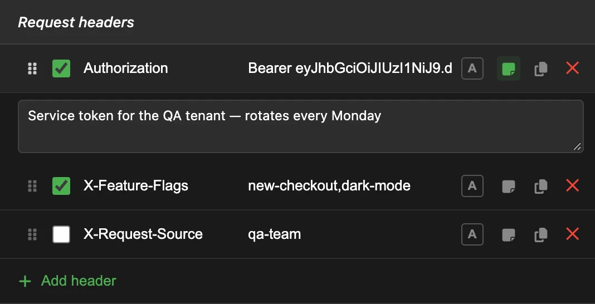
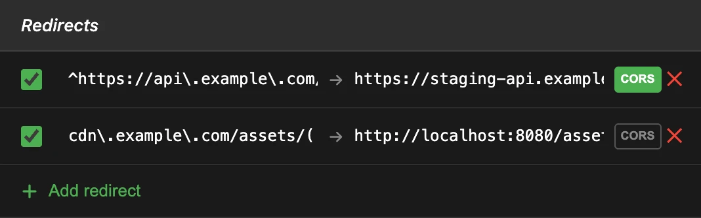
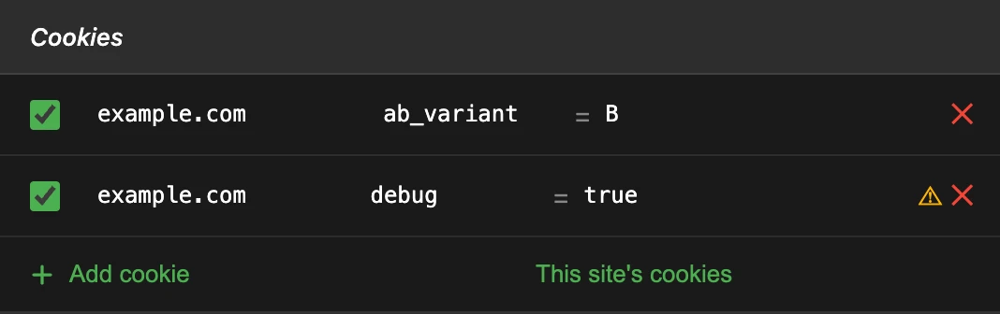

# Header Editor Pro - Free

**Edit HTTP headers, redirect requests and add cookies — one profile per environment**

A free, open-source extension for Chrome and Firefox. Test against staging, debug
auth and CORS, and switch environments without touching code.

[Add to Chrome](https://chromewebstore.google.com/detail/cpdkigffbilaglfmddclhgfflimpaeim) ·
[Add to Firefox](https://addons.mozilla.org/firefox/addon/header-editor-pro-free/) ·
[Website](https://testacode.github.io/header-editor-pro-free/)

Free · Open source · No account · No tracking

## What it does

### Request and response headers

Set, append or remove any header. Each one has its own switch and an optional
note, so six months from now you still know why that token is there.

### Redirects between environments

Send requests that match a regular expression to another URL — staging, a local
server — using `$1` capture groups. Turn on CORS when the target is on another origin.

### Cookies per profile

Add cookies to a domain's requests without writing them to the browser. They stop
the moment you pause or switch profile, and a warning tells you when the site
already sets one with the same name.

## Also included

- **Profiles and filters** — As many profiles as you need, each limited to some domains or, in Chrome, to a tab group.
- **Import and export** — JSON backups, profile lists from other header editors, and Requestly redirect rules.
- **Share what's on** — Copy a profile's enabled items; a teammate imports them as a ready-made profile.
- **Pause** — Turn every rule off in one click without losing any of them.
- **Set or append** — Append to multi-value headers such as Accept or Cookie instead of replacing them.
- **Light or dark, 7 languages** — English, Español, 日本語, 한국어, Русский, 简体中文, 繁體中文 ([spot a bad translation?](https://github.com/testacode/header-editor-pro-free/issues/new?template=translation.yml)).

## Common uses

| | |
|---|---|
| Call an authenticated endpoint | `Authorization: Bearer <token>` |
| Point a frontend at staging | `api.example.com → staging-api.example.com` |
| Debug CORS | `Access-Control-Allow-Origin: *` |
| Force a feature flag or A/B variant | `Cookie: ab_variant=B` |

## Your data stays in your browser

Profiles are stored locally. The extension has no servers, no analytics and no
account, and the rules run inside the browser itself, so it never sees the requests
it changes. The code is right here if you want to check —
[read the privacy policy](https://testacode.github.io/header-editor-pro-free/privacy.html).

## Documentation

| Guide | What's in it |
|---|---|
| [Usage](docs/usage.md) | Profiles, headers, redirects, cookies, filters, toolbar, permissions |
| [Development](docs/development.md) | Project structure, local setup, playground, build, releases |
| [i18n](docs/i18n.md) | How translations work, in the extension and on the site |
| [Gotchas](docs/GOTCHAS.md) | Hard-won bugs and undocumented behaviour |
| [History](docs/history/) | Why past releases turned out the way they did |

## Free, and nobody's paying for it

This extension costs nothing, and no one pays me to maintain it or to build new
things into it. It gets better in my own time.

Want something improved? [Open an issue](https://github.com/testacode/header-editor-pro-free/issues)
and let's talk it through — that's free too, and it's the best way in.

Chip in and your request moves up my queue. And if you'd rather not, no hard
feelings — nobody ever turned down a glass of water ;)

[Buy me a coffee](https://buymeacoffee.com/charlybrown) ·
[Sponsor on GitHub](https://github.com/sponsors/testacode)

Either way, it stays free for everyone.

---

[MIT License](LICENSE)
